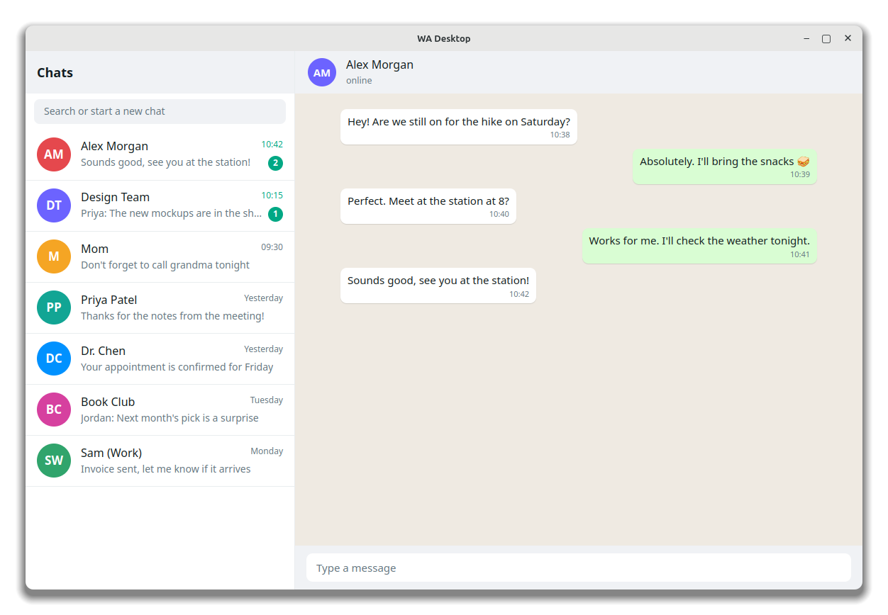
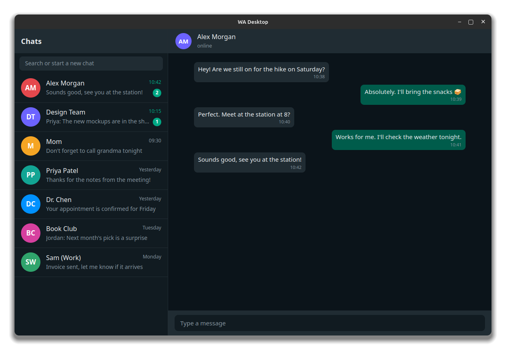
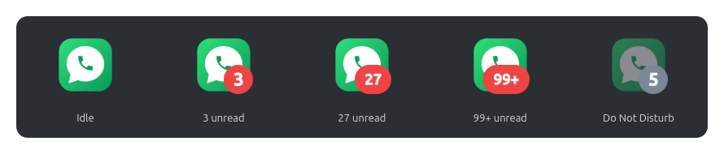
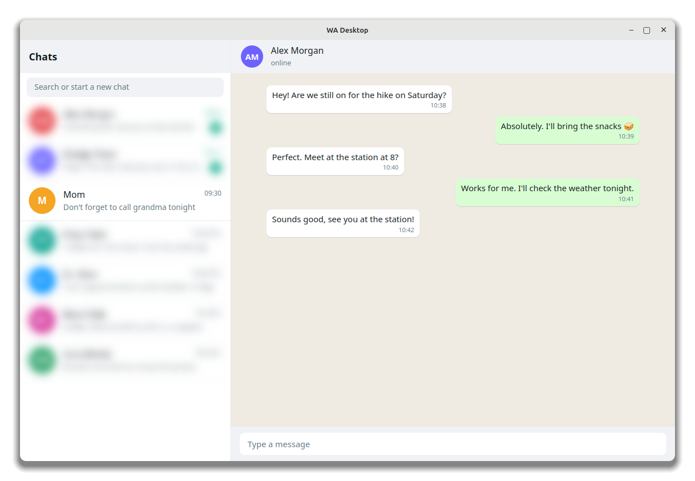
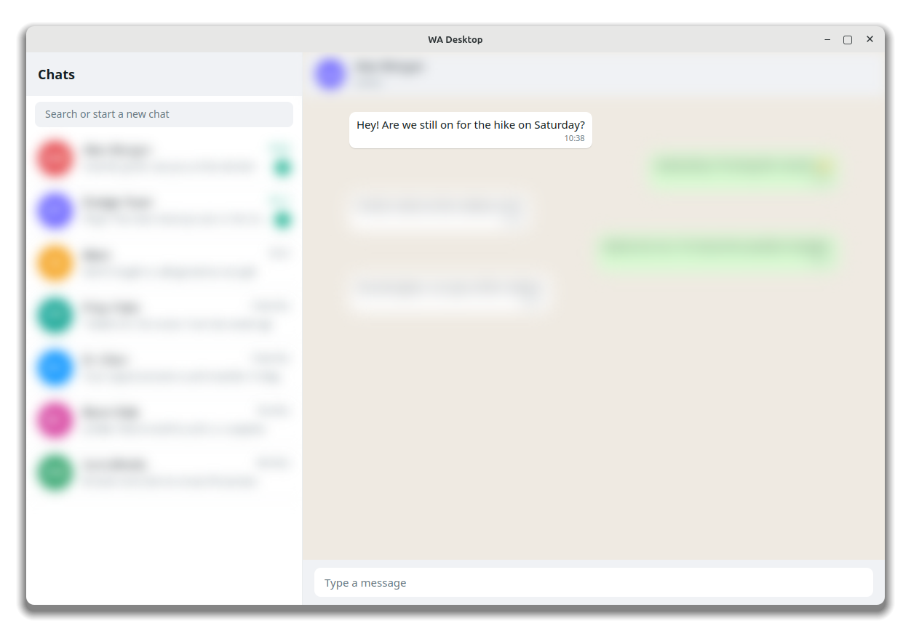
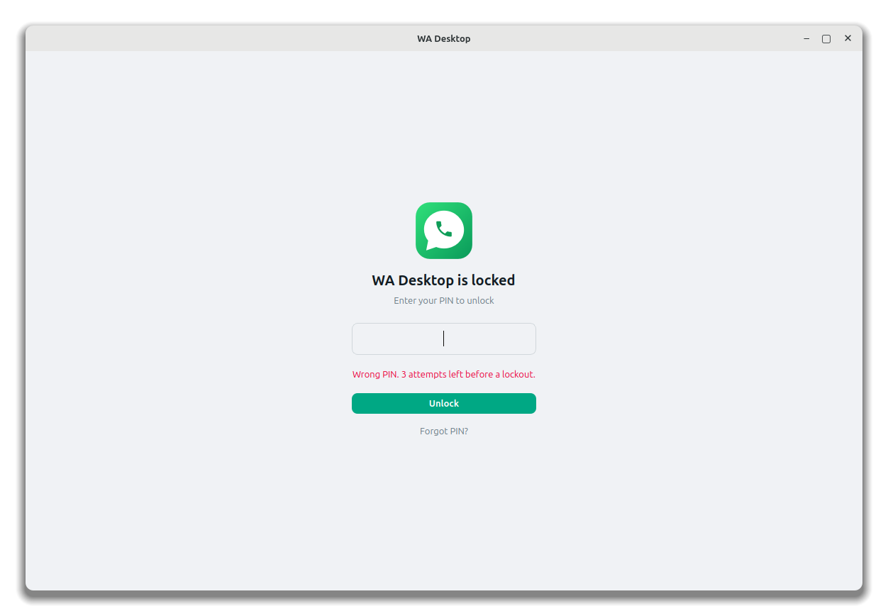
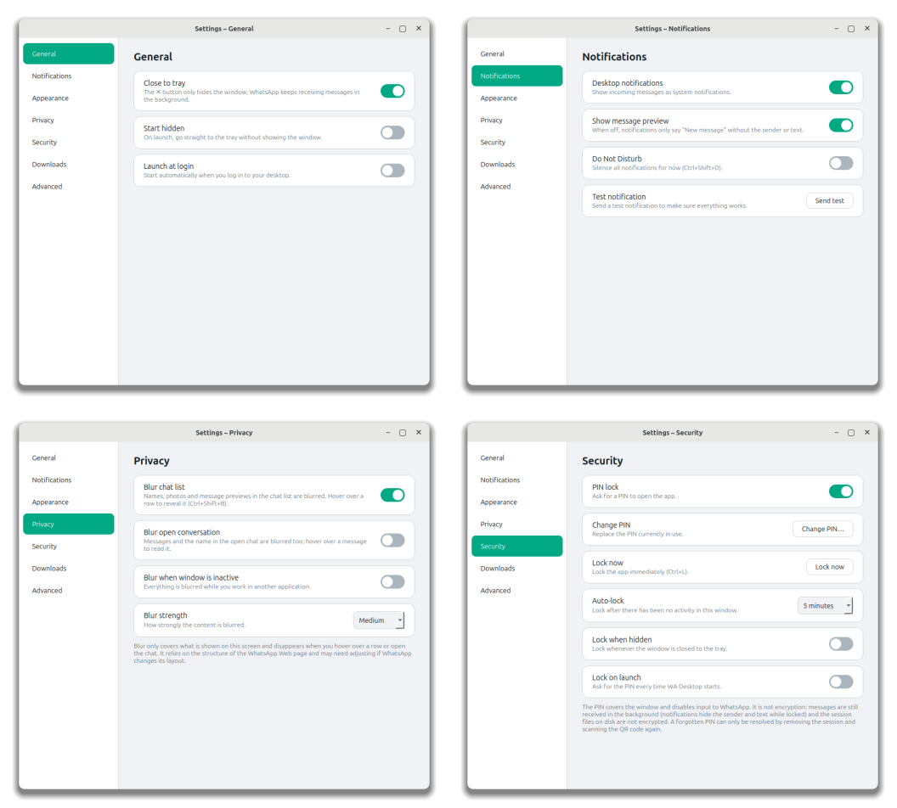
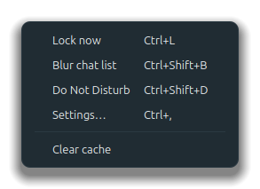

<div align="center">


# WA Desktop

**WhatsApp on your Linux desktop — in its own window, no browser required.**

Native tray icon, real desktop notifications, a PIN lock and a privacy blur mode.<br>
Built with Python and PySide6 (Qt WebEngine).

[](LICENSE)




<sub>All screenshots in this document use fictional demo data.</sub>

</div>

> **Unofficial project.** WA Desktop is not affiliated with, endorsed by, or connected to WhatsApp LLC or Meta.
> It simply hosts the official WhatsApp Web client in a dedicated window. See the [disclaimer](#disclaimer).

---

## Table of contents

- [Why WA Desktop?](#why-wa-desktop)
- [Features](#features)
- [Requirements](#requirements)
- [Installation](#installation)
- [Getting started](#getting-started)
- [Keyboard shortcuts](#keyboard-shortcuts)
- [Settings reference](#settings-reference)
- [Privacy & security notes](#privacy--security-notes)
- [Troubleshooting](#troubleshooting)
- [How it works](#how-it-works)
- [Development](#development)
- [Roadmap](#roadmap)
- [Disclaimer](#disclaimer)
- [License](#license)

## Why WA Desktop?

WhatsApp offers no official desktop app for Linux, so most people keep a browser tab open. That tab is easy
to lose, has no tray icon, and gives you no control over who can see your chats. WA Desktop gives WhatsApp
Web a proper home on the desktop:

- it lives in the **system tray** and shows an **unread badge**,
- it sends **native notifications** you can click to jump to the chat,
- it can **blur sender names** and **lock itself with a PIN** when you step away,
- it installs with **one command** and keeps your login between launches.

## Features

### A real desktop app

- **Persistent login** — scan the QR code once; the session survives restarts.
- **System tray** with an unread-message badge on both the tray icon and the taskbar icon. Closing the window
  keeps the app running in the background.
- **Single instance** — launching the app again simply raises the existing window.
- **Launch at login** and **start hidden in the tray**.
- **Light / dark / follow-system theme**, applied live to both the app and WhatsApp Web itself.
- **Zoom** (Ctrl +/−/0 or Ctrl + mouse wheel), **fullscreen** (F11) and an optional **menu bar**.
- **Downloads** go to your chosen folder, never overwrite existing files, and show a "Show in folder" action.
- **Links open in your default browser**, not inside the app.
- **Loading screen and offline handling** with automatic retry.

<div align="center">

</div>

### Native notifications

- Uses your desktop's own notification system (via `notify-send`), including the sender's avatar when WhatsApp provides one.
- **Click a notification to open the app** and the related chat.
- **Do Not Disturb** mode (Ctrl+Shift+D) and an option to hide the message preview.
- A built-in **test notification** button to check that everything works.

<div align="center">

</div>

### Privacy blur

Keep your contact list out of sight on a shared or visible screen. Names, photos and message previews in the
chat list are blurred; **hover over a row to reveal it**, or open a chat to read it. Only the chat you open is
readable.

<div align="center">

</div>

- **Blur chat list** (Ctrl+Shift+B toggles it instantly).
- **Blur open conversation** — messages are blurred too and revealed on hover.
- **Blur when window is inactive** — everything is blurred while you work in another application.
- Four blur strengths: Light, Medium, Strong, Maximum.

<div align="center">

</div>

### PIN lock

- Lock the app manually (Ctrl+L) or automatically: **after inactivity** (1 minute – 1 hour), **when the window is
  hidden to the tray**, and/or **on launch**.
- While locked, input to WhatsApp is disabled, Settings cannot be opened, and **notifications show only
  "New message"** — no sender, text or avatar.
- PINs are stored as a salted **PBKDF2-HMAC-SHA256** hash (200,000 iterations), never in plain text.
- Wrong PINs trigger an increasing lockout (30 s, 60 s, 120 s … up to 10 minutes) after five attempts.
- *Forgot your PIN?* It cannot be recovered; the only way out is removing the session and scanning the QR code
  again.

<div align="center">

</div>

### Everything is configurable

A clean settings dialog (Ctrl+,) covers every option. The menu bar is hidden by default — press **Alt** or
**Ctrl+M** to show it.

<div align="center">

</div>

<div align="center">

</div>

## Requirements

| | |
|---|---|
| **OS** | A Linux distribution with **glibc 2.34+** — e.g. Ubuntu 22.04+, Debian 12+, Linux Mint 21+, Fedora 35+ |
| **Architecture** | x86_64 or aarch64 |
| **Python** | 3.10 or newer (with the `venv` module) |
| **Desktop** | A notification daemon and system-tray support (works out of the box on Cinnamon, KDE, XFCE, MATE; GNOME needs an AppIndicator extension) |
| **Disk / network** | About 260 MB to download and ~700 MB installed (PySide6 + Qt WebEngine / Chromium) |

> **Tested on:** Linux Mint 22 (Cinnamon, X11) with PySide6 6.12. Other distributions and Wayland sessions should
> work but have **not** been tested yet — please report what you find.

## Installation

### Linux Mint, Ubuntu and Debian (recommended)

```bash
git clone https://github.com/pahrulirfan/wa-desktop.git
cd wa-desktop
./install.sh
```

The installer will:

1. check your Python version, CPU architecture and glibc,
2. offer to install any missing system libraries with `sudo apt` (it asks before doing so),
3. create a private virtual environment in `~/.local/share/wadesk` and install PySide6 + Qt WebEngine,
4. add a launcher (`~/.local/bin/wadesk`), an icon and an **application-menu entry**.

Everything except step 2 is installed **for your user only** — no root access is needed for the app itself.

Then open **WA Desktop** from your application menu, or run `wadesk`.

> If the shell reports `wadesk: command not found`, `~/.local/bin` is not in your `PATH` yet. Run
> `~/.local/bin/wadesk` once, or log out and back in.

**Installer options**

| Option | Meaning |
|---|---|
| `--no-apt` | Do not touch system packages (for non-Debian distributions or when you installed them yourself) |
| `-y`, `--yes` | Do not ask before running `apt-get install` |
| `-h`, `--help` | Show help |

### Other distributions (Fedora, Arch, openSUSE, …)

Install the runtime libraries with your package manager, then run the installer with `--no-apt`.

<details>
<summary>Suggested packages <em>(untested starting points)</em></summary>

| Distribution | Packages |
|---|---|
| **Fedora** | `python3 xcb-util-cursor xcb-util-image xcb-util-keysyms xcb-util-renderutil xcb-util-wm nss alsa-lib libnotify libxkbcommon-x11` |
| **Arch / Manjaro** | `python xcb-util-cursor xcb-util-image xcb-util-keysyms xcb-util-renderutil xcb-util-wm nss alsa-lib libnotify libxkbcommon-x11` |

</details>

```bash
./install.sh --no-apt
```

### Run from source (without installing)

```bash
python3 -m venv .venv
source .venv/bin/activate
pip install -r requirements.txt
python -m wadesk
```

On Debian-based systems you still need the system libraries listed above (at least `libxcb-cursor0`,
`libnss3`, `libasound2` and `libnotify-bin`).

### Updating

Pull the latest version and run `./install.sh` again. Your login session and settings are kept.

### Uninstalling

```bash
./uninstall.sh            # remove the app, keep your session and settings
./uninstall.sh --purge    # also delete the session, settings and cache
```

If WA Desktop is running, quit it from its tray icon first.

## Getting started

1. Launch **WA Desktop**.
2. On your phone open **WhatsApp → Settings → Linked devices → Link a device** and scan the QR code. Leave
   **Keep me signed in on this browser** ticked so the session persists.
3. **Turn on notifications inside WhatsApp:** open **Settings (⚙️) → Notifications** in the web interface and
   switch on **Messages** (and **Groups** / **Status** if you want them). The app already grants the browser-level
   permission, but WhatsApp keeps its own separate switch — see [Troubleshooting](#troubleshooting).
4. Optional: open **Settings → Security** to set a PIN, and **Settings → Privacy** to enable blur.

**Command-line options**

| Option | Meaning |
|---|---|
| `wadesk --minimized` | Start hidden in the system tray |
| `wadesk --version` | Print the version |

## Keyboard shortcuts

| Shortcut | Action |
|---|---|
| **Ctrl+,** | Open Settings |
| **Ctrl+L** | Lock now *(when a PIN is set)* |
| **Ctrl+Shift+B** | Toggle chat-list blur |
| **Ctrl+Shift+D** | Toggle Do Not Disturb |
| **Ctrl+W** | Hide window to the tray |
| **Ctrl+Q** | Quit |
| **F5** / **Ctrl+R** | Reload |
| **F11** | Toggle fullscreen |
| **Ctrl +** / **Ctrl −** / **Ctrl 0** | Zoom in / out / reset (Ctrl + mouse wheel also works) |
| **Alt** / **Ctrl+M** | Show or hide the menu bar |

The tray icon's menu offers *Open*, *Do Not Disturb*, *Lock now*, *Settings* and *Quit*. A left-click on the tray
icon shows or hides the window.

## Settings reference

<details open>
<summary><strong>General</strong></summary>

| Setting | Default | Description |
|---|---|---|
| Close to tray | On | The ✕ button hides the window; WhatsApp keeps receiving messages |
| Start hidden | Off | On launch, go straight to the tray |
| Launch at login | Off | Adds an autostart entry (`~/.config/autostart/wadesk.desktop`) |

</details>

<details>
<summary><strong>Notifications</strong></summary>

| Setting | Default | Description |
|---|---|---|
| Desktop notifications | On | Show incoming messages as system notifications |
| Show message preview | On | When off, notifications say only "New message" |
| Do Not Disturb | Off | Silence all notifications |
| Test notification | – | Sends a test notification |

</details>

<details>
<summary><strong>Appearance</strong></summary>

| Setting | Default | Description |
|---|---|---|
| Theme | Follow system | Light, Dark or Follow system — also applied to WhatsApp Web |
| Zoom | 100 % | 50 % – 200 % |
| Menu bar | Off | Always show the menu bar |

</details>

<details>
<summary><strong>Privacy</strong></summary>

| Setting | Default | Description |
|---|---|---|
| Blur chat list | Off | Blur names, photos and previews; hover to reveal |
| Blur open conversation | Off | Blur messages and the contact name in the open chat |
| Blur when window is inactive | Off | Blur everything while another window has focus |
| Blur strength | Medium | Light (4 px), Medium (8 px), Strong (14 px), Maximum (22 px) |

</details>

<details>
<summary><strong>Security</strong></summary>

| Setting | Default | Description |
|---|---|---|
| PIN lock | Off | Create or remove the PIN (4–32 characters) |
| Change PIN | – | Requires the current PIN |
| Lock now | – | Lock immediately |
| Auto-lock | Never | After 1 / 5 / 15 / 30 minutes or 1 hour without activity in the window |
| Lock when hidden | Off | Lock each time the window is closed to the tray |
| Lock on launch | On | Ask for the PIN every time the app starts |

</details>

<details>
<summary><strong>Downloads</strong> and <strong>Advanced</strong></summary>

| Setting | Default | Description |
|---|---|---|
| Download folder | `~/Downloads` | Where files are saved |
| Ask where to save | Off | Show a save dialog for each file |
| Disable GPU acceleration | Off | Try this if the window flickers or stays blank (restart required) |
| Custom user agent | Automatic | Override if WhatsApp rejects the browser (restart required) |
| Clear cache | – | Deletes the network cache; your login is unaffected |
| Data folder | – | Opens `~/.local/share/wadesk` |
| Log out | – | Deletes the session so you must scan the QR code again |

</details>

**Where data is stored**

| What | Location |
|---|---|
| Settings | `~/.config/wadesk/settings.json` |
| Login session, cookies, local storage | `~/.local/share/wadesk/webengine/` |
| Cache | `~/.cache/wadesk/` |
| Autostart entry (if enabled) | `~/.config/autostart/wadesk.desktop` |

## Privacy & security notes

- WA Desktop contains **no analytics or telemetry** and talks to no server other than WhatsApp's. Your messages
  remain end-to-end encrypted by WhatsApp.
- The **PIN lock is a convenience lock, not encryption.** It covers the window and disables input, but the
  session files in `~/.local/share/wadesk` are not encrypted, WhatsApp keeps receiving messages in the
  background, and the failed-attempt counter lives in memory (it resets when the app restarts). Protect your
  user account and disk (for example with full-disk encryption) if you need stronger guarantees.
- **Privacy blur is cosmetic and best-effort.** It relies on the structure of the WhatsApp Web page; if WhatsApp
  changes its markup, some elements may stop being blurred. If you notice that, please open an issue.
- Anyone with access to your unlocked desktop session can also read the files that hold your session.
  Use **Log out** in Settings → Advanced before giving the machine to someone else.

## Troubleshooting

<details>
<summary><strong><code>wadesk: command not found</code></strong></summary>

`~/.local/bin` is not in your `PATH` for the current terminal. Run `~/.local/bin/wadesk`, or:

```bash
export PATH="$HOME/.local/bin:$PATH"
```

It is added automatically at your next login. The application-menu entry and autostart are not affected.
</details>

<details>
<summary><strong><code>Could not load the Qt platform plugin "xcb"</code></strong></summary>

A system library is missing — usually `libxcb-cursor0`. On Debian/Ubuntu/Mint:

```bash
sudo apt install libxcb-cursor0 libxkbcommon-x11-0 libxcb-icccm4 libxcb-image0 libxcb-keysyms1 libxcb-render-util0 libxcb-shape0
```

Re-running `./install.sh` installs them for you.
</details>

<details>
<summary><strong>Sound plays and the unread counter updates, but no desktop notification appears</strong></summary>

WhatsApp Web has its own notification switch, separate from the browser permission. Open
**Settings (⚙️) → Notifications** inside WhatsApp and turn **Messages** (and **Groups** / **Status**) on.

Also note that WhatsApp deliberately suppresses notifications while its window is focused and the sender's chat
is open — test with the window hidden to the tray.

Still nothing? Use **Settings → Notifications → Send test**. If the test notification appears, the desktop side
works and the problem is WhatsApp's own notification setting; if it does not, check that `notify-send` is installed
(`sudo apt install libnotify-bin`) and that your notification daemon is running, then open an issue.
</details>

<details>
<summary><strong>No tray icon</strong></summary>

The app needs a system-tray host. Cinnamon, KDE, XFCE and MATE provide one. On **GNOME**, install the
*AppIndicator and KStatusNotifierItem Support* extension. Without a tray the window simply closes normally.
</details>

<details>
<summary><strong>Blank, black or flickering window</strong></summary>

Enable **Settings → Advanced → Disable GPU acceleration** and restart the app. You can also try launching with
`QTWEBENGINE_CHROMIUM_FLAGS="--disable-gpu" wadesk`.
</details>

<details>
<summary><strong>WhatsApp says the browser is not supported / asks to update Chrome</strong></summary>

WA Desktop presents itself as a regular Chrome browser. If WhatsApp ever raises its minimum version, set a
current Chrome user agent in **Settings → Advanced → Custom user agent** and restart.
</details>

<details>
<summary><strong>Wayland</strong></summary>

Untested. If you see rendering or tray problems, force X11: `QT_QPA_PLATFORM=xcb wadesk`.
</details>

<details>
<summary><strong>I forgot my PIN</strong></summary>

It cannot be recovered. On the lock screen choose **Forgot PIN?** — this removes the WhatsApp session from the
computer and turns the lock off. You will need to scan the QR code again.
</details>

## How it works

WA Desktop is a thin, focused wrapper around Qt WebEngine (Chromium):

- **Profile** — a persistent profile stores cookies and local storage, so WhatsApp Web keeps you signed in. The
  user agent is presented as plain Chrome; the `Accept-Language` header follows your system locale, so WhatsApp
  appears in your own language while the app's interface is English.
- **Notifications** — Qt delivers web notifications to a Python presenter, which forwards them to `notify-send`
  with the sender's avatar (when available) and a *click-to-open* action (falling back to tray messages when `notify-send` is not
  installed). Notification permission for `web.whatsapp.com` is granted automatically.
- **Unread badge** — WhatsApp Web exposes the unread count in the page title (`(3) WhatsApp`); the app reads it
  and renders it onto the tray and window icons.
- **Privacy blur** — a small stylesheet is injected into the page. Hovering a row removes its blur, so the same
  mechanism reveals names on demand.
- **PIN lock** — an opaque overlay covers the web view, the view is disabled, and idle time is tracked from input
  events delivered to the web view.
- **Links and pop-ups** — navigation away from WhatsApp, and `window.open()`, are handed to your default browser.

## Development

```bash
git clone https://github.com/pahrulirfan/wa-desktop.git
cd wa-desktop
python3 -m venv .venv && source .venv/bin/activate
pip install -r requirements.txt
python -m wadesk
```

**Project layout**

```
wa-desktop/
├── install.sh / uninstall.sh      installer and uninstaller (user-level, no root for the app)
├── requirements.txt               PySide6 + Qt WebEngine
├── packaging/wadesk.desktop       application-menu entry template
├── tools/
│   ├── make_screenshots.py        regenerates docs/images from the real UI (demo data only)
│   └── demo_chat.html             fictional chat page used for the screenshots
├── docs/images/                   README screenshots
└── wadesk/
    ├── app.py                     entry point, wiring, single-instance handling
    ├── window.py                  main window, menus, zoom, lock integration
    ├── webpage.py                 profile, page, permissions, downloads, link handling
    ├── notifier.py                desktop notifications
    ├── privacy.py                 blur CSS injection
    ├── lock.py                    PIN hashing, lock screen, PIN dialogs
    ├── dialogs.py                 settings dialog and About box
    ├── tray.py                    tray icon and badge rendering
    ├── widgets.py                 toggle switch, loading overlay, toast
    ├── settings.py / paths.py     persistent settings and XDG locations
    ├── theme.py                   light/dark themes
    └── autostart.py               launch-at-login entry
```

**Regenerating the screenshots** (needs a desktop session; uses a throw-away profile and never touches your
real session):

```bash
python tools/make_screenshots.py
```

**Reporting bugs:** please include the output of `wadesk --version`, your distribution and desktop environment,
and whether you use X11 or Wayland. Start the app from a terminal and include any error messages it prints
(remove personal information first).

Contributions are welcome. Open an issue to discuss larger changes before sending a pull request.

## Roadmap

These are ideas, not commitments:

- [ ] **Snap Store package.** Confinement will need the tray (StatusNotifier over D-Bus), notifications (moving
      from `notify-send` to a D-Bus/portal call) and opening links via the desktop portal.
- [ ] Other packaging formats (`.deb`, Flatpak, AppImage).
- [ ] Global shortcut to show/hide the window.
- [ ] Verified spell-check dictionaries and voice/video-call support, depending on what WhatsApp Web allows.
- [ ] Automated tests and CI.

## Disclaimer

WA Desktop is an independent, community project. **WhatsApp** is a trademark of WhatsApp LLC; this project is
not affiliated with, authorised, maintained, sponsored or endorsed by WhatsApp LLC, Meta Platforms, Inc. or any
of their affiliates. The application icon is original artwork.

The app loads the official WhatsApp Web client and does not use any unofficial messaging API. Even so, you are
responsible for using it in line with WhatsApp's Terms of Service. The software is provided "as is", without
warranty of any kind.

## License

Released under the [MIT License](LICENSE).
